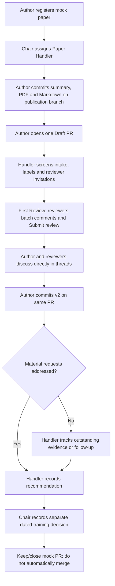

# LSST ISSC Publication Committee — GitHub review sandbox

> **Training repository, not an official publication-clearance portal.** This repository is **public**. Use only fictional or explicitly public materials. Do not upload confidential manuscripts, restricted Rubin data, private correspondence, reviewer identities requiring confidentiality, or personal information. The current approved ISSC publication policy takes precedence over this training guide.

This sandbox tests a transparent **internal scientific-readiness and collaboration-review workflow**. The process does **not** substitute for independent journal peer review, and GitHub's `Approve` / `Merge` controls are **not** ISSC or journal publication decisions.

**The mock paper is submitted by a volunteer author using a new branch and Draft Pull Request (PR).** It should **not** be preloaded into `main`. All participants review the *same actual PR*. Do not reuse the older demonstration PRs.

## Start here — instructions by role

| Your role | Read first | Your initial action |
|---|---|---|
| Volunteer author | [Author handoff](AUTHOR_HANDOFF.md), [role cards](ROLE_INSTRUCTIONS.md), [format conversion](CONVERT_TO_MARKDOWN.md) | Open one Draft PR with `summary.md`, `manuscript_v1.pdf` and `manuscript_v1.md` |
| Paper Handler | [Role cards](ROLE_INSTRUCTIONS.md), [review protocol](REVIEW_PROTOCOL.md), [runbook](EXERCISE_RUNBOOK.md) | Screen the submission; assign reviewers, labels and dates |
| Reviewer | [Review protocol](REVIEW_PROTOCOL.md), [role cards](ROLE_INSTRUCTIONS.md) | Read the PDF; use **Start a review** to collect Markdown comments, then **Submit review** |
| Chair | [Exercise runbook](EXERCISE_RUNBOOK.md), [role cards](ROLE_INSTRUCTIONS.md) | Appoint Handler and confirm reviewer coverage |
| Observer | [Debrief checklist](DEBRIEF_CHECKLIST.md) | Record usability, permissions and notification issues |

[Open PRs](https://github.com/lionandjelka/pubcom-sandbox-test/pulls) · [Submission summary template](Publications/summary_doc_template.md) · [Full asynchronous pilot guide](ASYNC_EXERCISE_GUIDE.md)

## What lives where?

| Item | Purpose |
|---|---|
| `Publications/<paper-slug>/summary.md` | The authoritative **registration metadata** (title, contacts, class/category, data rights, manuscript versions, dates) |
| `manuscript_v1.pdf` | The readable, formatted **scientific manuscript** |
| `manuscript_v1.md` | Optional for future real-policy decisions, but **used in this pilot** as the line-commentable companion to the PDF |
| Pull Request **Conversation** and **Files changed** | The authoritative **review record**: requests, replies, updated versions, Handler recommendation and Chair decision |

Do not copy the entire summary into the PR description. Include short links and a review checklist. When linking files from a PR description, use actual GitHub **blob URLs on the paper's branch**, not ambiguous relative paths that can open the Compare page.

## Workflow at a glance

## Review comments and notifications — meeting update (11 November 2026)

An author in the first test received a separate email for each review comment. To reduce notification noise, reviewers should **collect comments in a pending review instead of posting them one at a time**:

1. Open the PR → **Files changed** → locate `manuscript_v1.md`.
2. Hover the relevant line → click **+** → type the comment → **Start a review**, *not* **Add single comment**.
3. Repeat using **Add review comment** for other lines.
4. When the whole review is ready, select **Review changes / Submit review** (button wording may vary).
5. Add an overall summary, choose **Comment** for the pilot, then **Submit review**.

Pending comments are not normally visible to the author until the review is submitted. Batching reduces fragmented notifications but does **not guarantee exactly one email**, because GitHub notification settings differ. See [REVIEW_PROTOCOL.md](REVIEW_PROTOCOL.md) for screenshots-independent detailed steps and alternatives.

Authors and reviewers **may discuss submitted comments directly**; they need not wait for the Handler to authorize each reply. The Handler monitors deadlines, sends reminders, adjudicates difficult issues, and records the formal recommendation; the Chair issues a **separate** decision. A posted answer does not automatically resolve a scientific concern.

## PDF, Markdown and LaTeX — meeting update (11 November 2026)

For the **current mock exercise**, use both a PDF and Markdown manuscript. This tests GitHub's line-specific comment facility on a real paper-like submission. We have **not adopted a rule requiring Markdown for every real ISSC paper**.

- Preferred conversion when source exists: **LaTeX (`.tex`) → Pandoc → Markdown (`.md`)**.
- When only PDF exists: **PDF → Markdown** with extraction software, followed by careful checking; mathematical expressions can be damaged.
- The committee is also considering **PDF-only plus one consolidated referee report** for complex/long manuscripts. No format decision has yet been made.

Full installation and conversion instructions: **[CONVERT_TO_MARKDOWN.md](CONVERT_TO_MARKDOWN.md)**.

## Scientific comments, status and authority

- `Request:` substantive concern requiring a reasoned response; `Suggestion:` non-blocking improvement; `Question:` clarification needed. These are **text conventions**, not GitHub decision states.
- GitHub **Comment**, **Approve** and **Request changes** are **platform review outcomes**, not policy-defined ISSC outcomes.
- **Resolve conversation** closes a discussion in GitHub; it does not certify that evidence is sufficient. A reviewer may lack the permissions to resolve a thread; the Handler must document its scientific disposition separately.
- Unresolved threads prevent merging **only if the relevant branch protection / ruleset enforces conversation resolution**. Other permissions, including who can close or merge PRs, must be confirmed with the repository administrators.
- Scientific concerns are **not ranked by 👍 reaction counts**. The Handler considers their substance and explains unresolved requests.
- Review participation does **not automatically** grant authorship, builder status or a collaboration acknowledgement; current approved policies apply.

## Existing labels and templates

[Label definitions](.github/labels.yml) cover category (`Mandatory`, `Encouraged`, `Optional`), class (`class: a — paper`, etc.), timeline (`Accelerated`, `Standard`, `Extended`) and status (`status: first review`, `status: author response`, `status: follow-up review`, `status: released`, `status: concluded`). The Handler should keep **one current status label**; GitHub label definitions in YAML are not themselves a permissions scheme.

[PR template](.github/pull_request_template.md) and [publication summary template](Publications/summary_doc_template.md) support the intake. Slack/email registration may precede the PR; a GitHub Issue is optional and is **not** the manuscript review.

## Privacy and future official deployment

A public personal sandbox cannot be assumed to implement the privacy, branch protection, access and PR-close/merge restrictions required for actual scientific submissions. Reviewers may comment with read access, while editing branches, applying labels, resolving threads, and closing or merging may require different permissions. Specific controls must be verified on the target repository; **the committee has not approved a migration**.

The Chair will consult ISSC/LSST administrators (including Melissa and Alex, as appropriate) about official hosting, cross-collaboration access, confidentiality, and final authority. Do not infer that GitHub access confers scientific authorship or data rights.

## Pilot timetable and past examples

The [asynchronous exercise](ASYNC_EXERCISE_GUIDE.md) uses a **compressed 10-working-day simulation** for testing only, **not the formal ISSC review timelines**. Use the approved policy for any real manuscript.

Historical [walkthrough](DEMO_WALKTHROUGH.md) and [demonstration PR #6](https://github.com/lionandjelka/pubcom-sandbox-test/pull/6) are preserved for reference. They illustrate earlier training assumptions and are **not the authority** for review decisions, authorship, or journal permission. New trials should use distinct branches and PRs.

## Four phases

1. **Organizer:** check instructions, access, volunteers and safe fictional author packet; keep the answer key private.
2. **Author:** create own publication branch, upload PDF/Markdown/summary, open Draft PR.
3. **PubCom:** Handler activates the review; reviewers submit complete reviews; authors respond and commit revisions; Handler and Chair record separate dispositions.
4. **Debrief:** track notifications, scientific clarity, permissions and effort; retain/close training PR without automatically merging a fictional manuscript.
