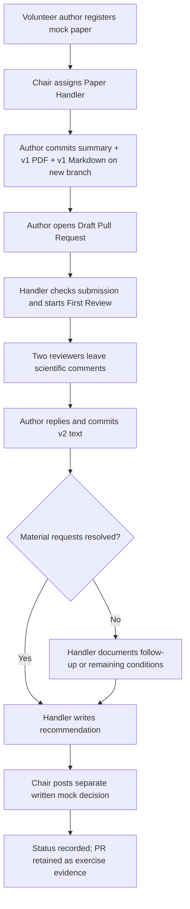

# LSST ISSC Publication Committee — GitHub review sandbox

**Training repository for a full publication-review exercise.** This public repository is **not** an official submission or clearance portal. All training documents and comments must use fictional or otherwise safe-to-publish content; do not post confidential manuscripts, restricted Rubin data, private correspondence, or personal information.

**The mock paper is deliberately submitted by a volunteer author through a new Draft Pull Request, not pre-loaded onto `main`.** PubCom members then review *that actual PR*. Do not merge the manuscript into `main` before the exercise.

## Begin here

| You are | Read | Your initial action |
|---|---|---|
| Volunteer submitting author | [Author handoff](AUTHOR_HANDOFF.md) and [role instructions](ROLE_INSTRUCTIONS.md) | Create one **Draft PR** containing a summary, manuscript Markdown and PDF |
| PubCom Chair | [Session runbook](EXERCISE_RUNBOOK.md) | Assign a Paper Handler and confirm roles |
| Paper Handler | [Role instructions](ROLE_INSTRUCTIONS.md) and [review protocol](REVIEW_PROTOCOL.md) | Screen the submitted PR; apply labels, invite reviewers |
| Reviewer / ISSC participant | [Role instructions](ROLE_INSTRUCTIONS.md) | Read the submitted PDF, comment on manuscript Markdown in **Files changed** |
| Observer | [Debrief checklist](DEBRIEF_CHECKLIST.md) | Observe workflow bottlenecks and record findings |

[Open pull requests](https://github.com/lionandjelka/pubcom-sandbox-test/pulls) · [Publication summary template](Publications/summary_doc_template.md)

## The workflow

## Important distinctions

- The **paper** is the manuscript PDF/Markdown submitted in a PR. The **summary document** is metadata and the review record; comments on the summary alone are not manuscript review.
- **`Request:`** at the beginning of a review comment means the reviewer believes an issue requires a substantive response. **`Suggestion:`** is advisory; **`Question:`** requests clarification. These prefixes are conventions, not automated GitHub statuses.
- GitHub **Review changes → Comment / Request changes / Approve** is a platform operation. It does **not** represent a final PubCom decision. For the live exercise, select **Comment**, unless the facilitator explicitly tests GitHub approval or review-blocking behaviour.
- **Unresolved conversations only block merging when the repository's branch protection/rulesets require their resolution**. The Handler must follow up regardless of automation.
- The committee's determination is a **separate dated comment by the Chair** after the Handler's recommendation. A merge or a GitHub approval is not permission to submit a real scientific paper.
- For the exercise, the decision may properly be **return for major revision**: the fictional manuscript contains intentionally unsubstantiated claims. A successful workflow test is not the same as scientific acceptance.

## Existing labels and templates

The sandbox's [label definitions](.github/labels.yml) cover Category (`Mandatory`, `Encouraged`, `Optional`), Class (`class: a — paper` etc.), Timeline (`Accelerated`, `Standard`, `Extended`) and workflow Status (`status: first review`, `status: author response`, `status: follow-up review`, `status: released`, `status: concluded`). One **current** status should be maintained at a time. The Paper Handler applies labels manually, even when label definitions are synced automatically.

The existing [PR template](.github/pull_request_template.md) and [publication summary](Publications/summary_doc_template.md) are for real *structure* but mock *content*. Registration may happen through the normal PubCom channel; GitHub Issues are optional and are not the review itself.

**Policy check:** this sandbox reflects the earlier ISSC publication-review workflow modeled here. Category definitions, formal timelines, authorship/attribution, data rights, reviewer obligations, and publication permission must be checked against the **current approved ISSC publication policy** before any real deployment. The mock session compresses elapsed review time for training and is not a completed policy-compliant real review.

## Preserve the existing practice material

The original [worked demonstration](DEMO_WALKTHROUGH.md) and [historical PR #6](https://github.com/lionandjelka/pubcom-sandbox-test/pull/6) remain useful evidence. They are separate from the **new mock submission**. Please do not modify or reuse old training PRs for the volunteer exercise.

## Four phases

1. **Organizer first:** merge the **repository instructions upgrade** into `main`, check access, appoint volunteers and distribute the *separate* fictional paper packet directly to the volunteer author.
2. **Author before the meeting:** opens their *own* Draft PR on a *different* publication branch containing the mock paper and completed metadata.
3. **PubCom during the exercise:** Handler activates the PR, reviewers comment on it, author revises, and Chair decides.
4. **Afterwards:** retain the PR or close it as a training record. Merge the paper only if specifically desired for sandbox recordkeeping, not because it is scientifically accepted.
